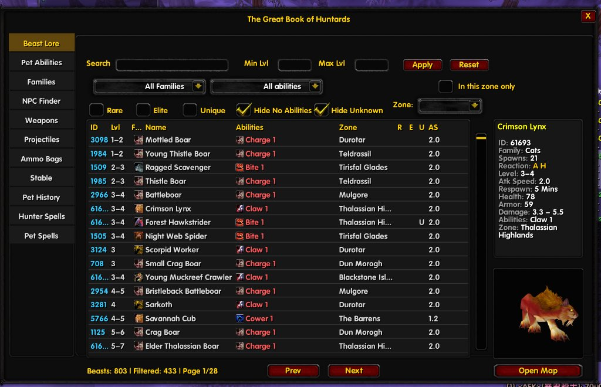
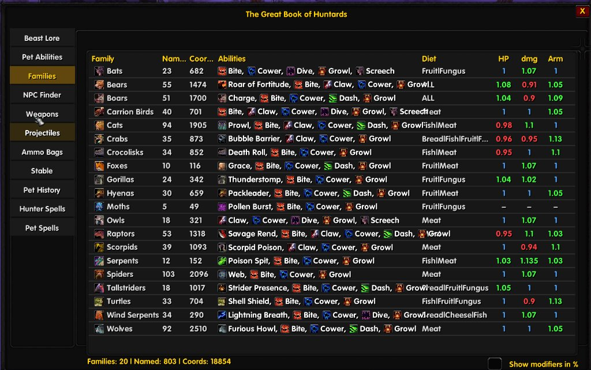
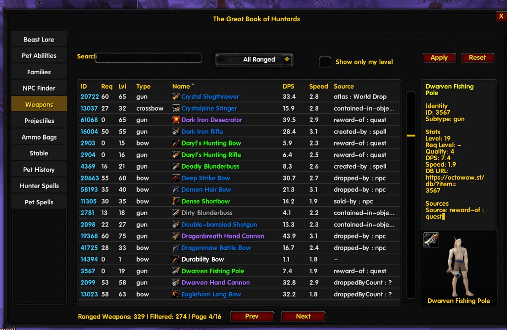
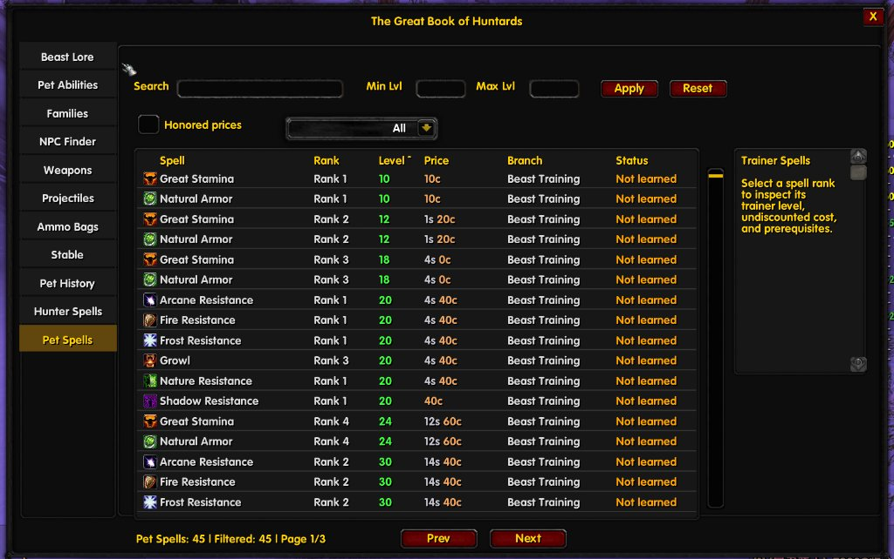
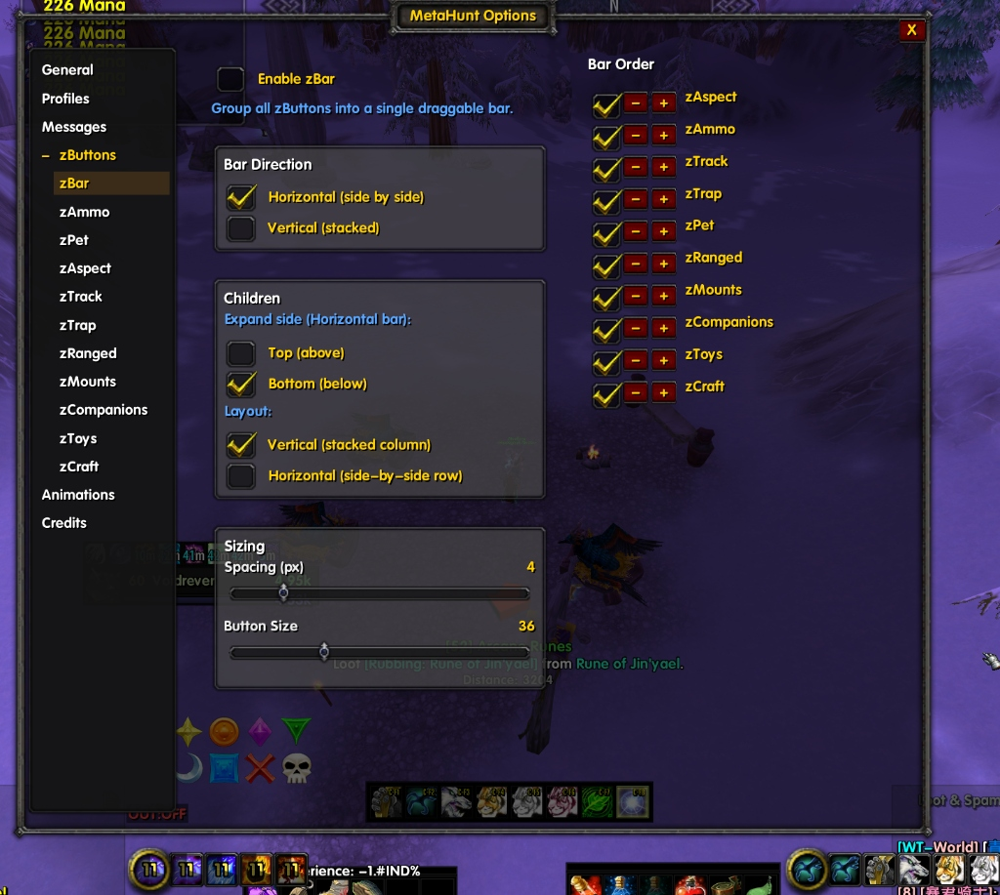

# HunterCodex (WoW 1.12 / Turtle WoW)

> Standalone Hunter Database (Beast Lore, Pet Abilities, Families, NPC Vendors, Ranged Weapons, Projectiles, Ammo Bags, Hunter Spells) with 3D Model & Icon Previews and zButtons.

## Client Mods Used
| Mod | Purpose in this addon | Required? |
|---|---|---|
| **ClassicAPI** | Detected at `PLAYER_LOGIN` (`CLASSIC_API_VERSION`) for diagnostics and optional `GetItemInfo` icon resolution | Optional |
| **Nampower** | Optional fallback icon resolution (`GetItemStats`, `GetItemIconTexture`, `GetSpellRec`, `GetSpellIconTexture`, `copy=1`), live server item stats, and target GUID (`GetUnitGUID`) | Optional |
| **SuperWoW** | Optional fallback spell icon resolution (`SpellInfo`), live spell data, and target GUID (`UnitExists`) | Optional |
| **UnitXP SP3** | Optional target distance & Line-of-Sight telemetry (`UnitXP("distanceBetween" / "inSight")`) | Optional |
| **VanillaHelpers** | Optional live target `nativeDisplayID` inspection (`UnitDisplayInfo`) for 3D previewing unindexed creatures/NPCs | Optional |

The addon runs in pure **Vanilla Lua 5.0** mode and works without any optional client DLL mods installed.

## Features
- **Beast Lore (`805` creatures):** Filter by name, level range, family, ability, or zone; view HP, armor, damage, attack speed, innate abilities, spawn coordinates, map markers, and **3D creature models** (`PlayerModel:SetUnit`).
- **Pet Abilities (`23` abilities, all ranks):** Browse every pet ability, rank, focus cost, cooldown, range, school, train level, spell icon, and which beasts/trainers teach it.
- **Families (`20` families):** Full coverage including **Foxes** and **Moths**, with family icons, HP/Armor/Damage modifiers, diets, and learnable abilities.
- **NPC Finder / Vendors (`193` NPCs):** Locate Ammo Vendors, Ranged Weapon Vendors, Hunter Trainers, Pet Trainers, and Stable Masters with faction, coordinates, and **3D NPC models** (`186/193` NPCs enriched with `displayId`).
- **Ranged Weapons:** Browse Bows, Crossbows, and Guns with DPS, speed, level requirements, sources, item icons, and **3D weapon preview** (`DressUpModel:TryOn`).
- **Projectiles & Ammo Bags:** Browse all Arrows, Bullets, Quivers, and Ammo Pouches with slot counts, DPS, quality, vendor/quest sources, and item icons.
- **Hunter Spells:** Browse baseline and talent Hunter spells (including TWoW 1.18.1 additions) with rank, cost, cast time, school, and trainer details.
- **zButtons:** Full `zHunterMod` suite (`zAmmo`, `zPet`, `zAspect`, `zTrack`, `zTrap`, `zRanged`, `zMounts`, `zCompanions`, `zToys`, `zCraft`, and `zBar`) with full Options configuration.

## Screenshots

### Beast Lore (3D Creature Preview)

### Pet Families (20 Families)

### Ranged Weapons (3D Model + Item Icon Preview)

### Pet Spells & Abilities

### zButtons & zBar Options

## What Was Added / Improved (vs MetaHunt)
- **Database Cross-Check & Updates:** Verified against Turtle WoW Hunter Pet spreadsheets and `database.capycraft.io`:
  - Added `[4660]` **Maraudine Bonepaw** (Hyena, lvl 37-38, `1.62` speed, `displayId 2710`) and `[63140]` **Tamed Ice Claw Bear** (Frostmane Hollow, lvl 13-15, `Claw 1`, `displayId 8840`).
  - Added `[63033]` **Old Whispershell**, `[60697]` **Soothound**, and `[61096]` **Venomflayer Serpent** (flagged `tameable = false` per database verification).
  - Corrected `27` fields across `26` existing beasts (decimal anomaly attack speeds such as `1.36` Razorscale, `1.23` Ravasaur Matriarch, `1.29` Duskskitterer, `1.23` Grunter, `1.18` Gretheer, `1.39` Ursol'lok, `1.48` Large Loch Crocolisk, `1.27` Greater Firebird; updated level ranges; added `Bubble Barrier 3` to `[92147]` Silver Coast Crawler).
- **3D Models & Icons:** Added 3D NPC model previews (`186` vendor `displayId`s), 3D ranged weapon previews (`DressUpModel:TryOn`), and item/spell icon resolution.
- **Focused & Unblocked:** Removed unrelated modules (`FeedOMatic`, `ICU`, `Chronometer`, `AutoBuy`, `AutoQuest`, `SmartAmmo`, `ExpAmmo`) and removed the realm gate block; isolated persistence to `HC_SavedVariables` / `HC_CharSavedVariables` for clean side-by-side testing.
- **Diagnostics & Tracing:** Added `/hc trace`, `/hc test`, and `/hc mods`.

## Usage
- `/hc` or `/huntercodex` — Toggle the HunterCodex Book window
- `/hc options` — Open Options panel (`zButtons`, `Profiles`, `Animations`, etc.)
- `/hc target` — Lookup your current target in Beast Lore / NPC Finder (or preview its 3D model)
- `/hc minimap` — Toggle the Minimap button
- `/hc trace [on|off]` — Toggle timestamped debug tracing in chat
- `/hc test` — Run the built-in in-game database & UI regression self-test
- `/hc mods` — Print detected client DLL mods

## Credits & License
- Upstream `MetaHunt` by **Metasploit** (HunterBook, Datastores, UI framework, Options)
- `zHunterMod` / `zButtons` original authors
- `PizzaSauce` animation library by **Pizzahawaii**
- `HunterCodex` database updates, 3D/icon extensions, diagnostics, and modular cleanup
